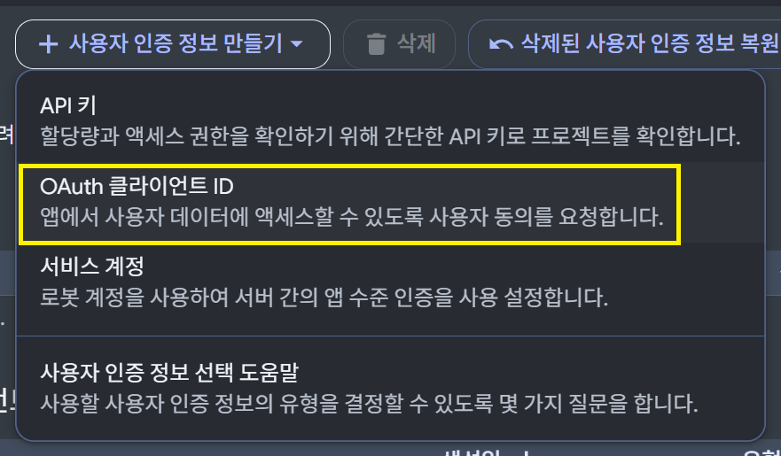
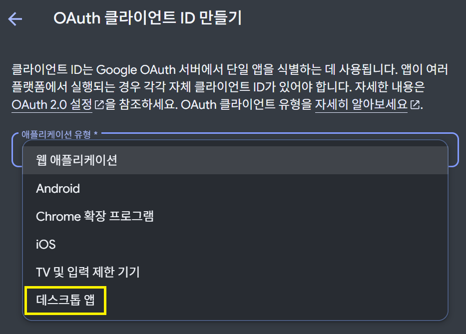
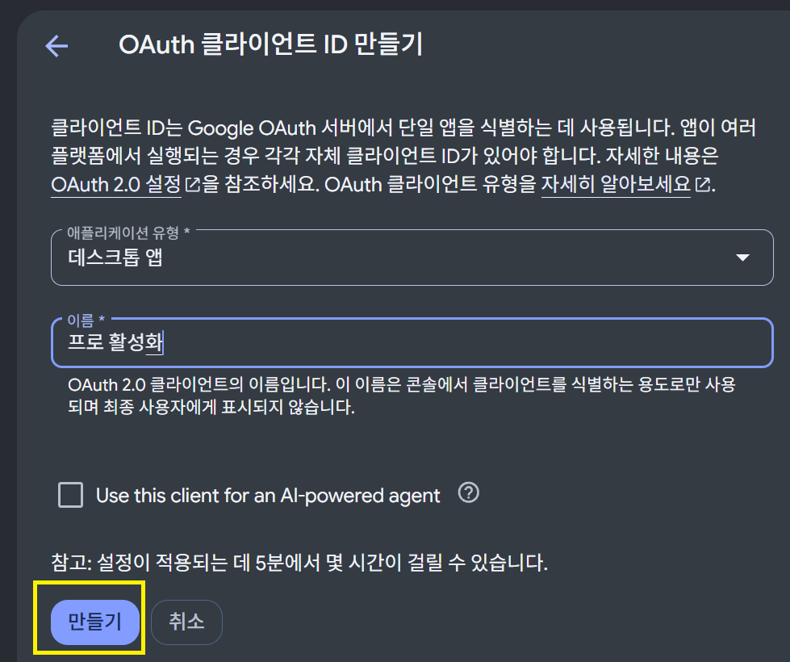
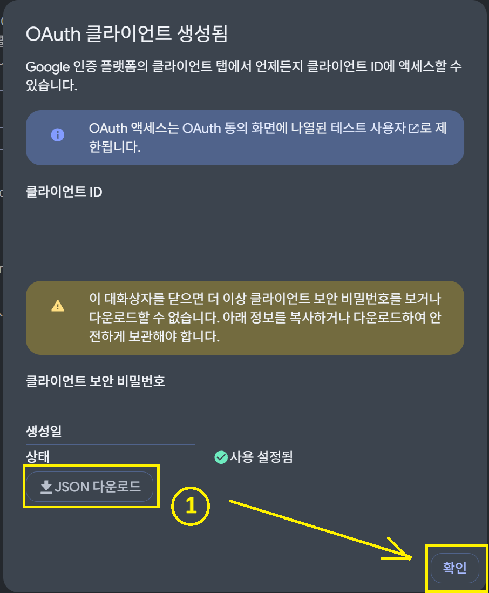
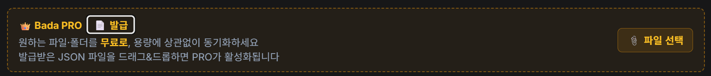

# ComfyUI Bada Utils — PRO Activation Guide

> Basic (BASIC) sync works right after installation. This document explains how to activate **PRO mode**.
> PRO runs synchronization with **your own Google account credentials**, so capacity (quota) is consumed from your project's limits.
> 💰 **It's completely free.** No subscription or payment required.

---

## 1. BASIC vs PRO

| | BASIC (default) | PRO |
|---|---|---|
| Credentials | Shared client embedded in the node | OAuth client **issued by you** |
| Setup steps | None — works immediately after install | Drag & drop one JSON file + Google login once |
| Capacity (quota) | Developer shared pool (consumed jointly by all users) | **Your project's Drive API limit** |
| Gemini chat history & custom-target sync | Excluded — kept on this device only | **Synced automatically** — continue on other PCs |
| Cost | Free (no subscription or payment) | **Free** (uses your own Google account, no extra billing) |
| Restart required | None | None — PRO badge appears immediately upon activation |

If BASIC is enough for you, this document isn't needed. Use PRO when you need high-volume/high-frequency sync or a dedicated quota.

---

## 2. Prerequisites

- A Google account
- Access to [Google Cloud Console](https://console.cloud.google.com) (used within the free tier — billing setup is mostly unnecessary; **no cost**)
- Select **your own project** from the project selector at the top, or create a new one (clients are issued per project)

---

## 3. Issue URL

[https://console.cloud.google.com/apis/credentials](https://console.cloud.google.com/apis/credentials)

Clicking the link opens the Credentials page directly (in a new tab).

---

## 4. How to issue (OAuth Client ID)

> Note: the screenshots below show the Google Cloud Console in Korean — button positions are identical in every language.

1. On the credentials page, click the **「Create credentials」** button in the top right.
2. Select **「OAuth client ID」** from the menu.

   
3. **Application type: choose 「Desktop app」** ← important
   - The desktop app type automatically allows `localhost` redirects, so no manual redirect URI registration is needed at all.

   
4. **Name**: enter a recognizable name (e.g., `BadaUtils-PRO`)
   - Display name only; it doesn't affect functionality.
5. Click the **「Create」** button.

   
6. ⚠️ On the creation-complete screen, **click 「Download JSON」 immediately** and store it in a safe place.

   > **The client secret is only visible on this screen.**
   > It cannot be viewed or re-downloaded later; if lost, you must create a new client (about 2 minutes).

   

7. Click **「OK」** to finish.

---

## 5. How to activate — Drag & Drop

1. Launch ComfyUI and open the **Bada Utils settings window**.
2. In the cloud sync section, **drag** the JSON file you just downloaded onto the **PRO activation zone** and drop it.
   - On touch devices, use the "Choose file" button instead.
3. The system automatically validates the file structure.
   - Wrong file → "This is not a Google OAuth client secret file" message
   - A copy of the BASIC credentials → rejected (BASIC credentials cannot be used as PRO)
4. Once validation passes, the **PRO badge appears immediately** in the UI — no ComfyUI restart needed.
5. The first time only, a Google login popup opens. Log in and consent to complete; it's maintained automatically thereafter.

---

## 6. After activation

- **Folder-specific sync**: choose your own Google Drive folder to sync.
- **Capacity**: usable within the limits of your Google account (project) — completely separated from the BASIC shared pool, so they don't affect each other.
- Deleting the PRO file automatically reverts to BASIC mode.

---

## 7. FAQ

**Q. I lost the JSON file.**
Create another desktop app client and download again (about 2 minutes). The old client can be deleted after activation is complete.

**Q. Do I need to register a redirect URI separately?**
No. The desktop app type automatically allows localhost redirects.

**Q. Does PRO consume my quota?**
Yes. Since synchronization runs with your project's credentials, Drive API quota is deducted from **your project's pool**. BASIC uses the developer shared pool.
But don't worry — 💰 **it's still completely free**, and Google's default per-project limit (Drive API: 10,000 queries/day) is **very generous** for personal use.

**Q. What happens if I don't use it for a long time?**
Google Cloud automatically deletes OAuth clients inactive for 6 months (recoverable within about 30 days). No impact if you're using it regularly.

---

## Appendix: File locations

| Item | Location |
|------|------|
| Dropped PRO credentials | Node root `credentials_pro.json` |
